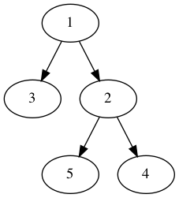

# menu_binary_tree

A small C learning project for creating and navigating a binary tree through a terminal menu. It also includes an example Graphviz output image for visualizing the tree structure.

## Status

This is an older learning project and is not actively maintained. I keep it public as part of my early C/data-structures work.

## What It Demonstrates

- Basic binary tree node operations in C
- Menu-driven terminal interaction
- Simple recursive tree output
- Early experimentation with Graphviz visualization

## Requirements

- GCC or another C compiler
- Graphviz, if you want to regenerate visual output

On macOS:

```bash
brew install graphviz
```

## Build And Run

```bash
bash Make.sh
./main
```

## Menu

```text
1 - create the tree
2 - create left child
3 - create right child
4 - remove child
5 - move up to parent
6 - enter left child
7 - enter right child
8 - show current parent
9 - exit
```

## Example Output

```text
1
left :2
    left :4
        left NULL
        right NULL
    right :5
        left NULL
        right NULL
right :3
    left :6
        left NULL
        right NULL
    right :7
        left NULL
        right NULL
```

<p align="center">
  
</p>
